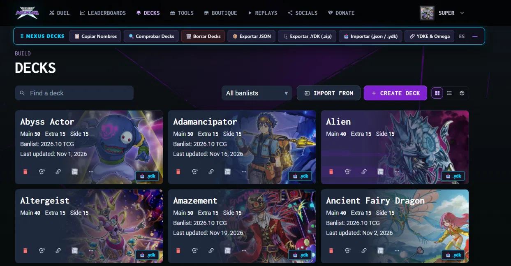
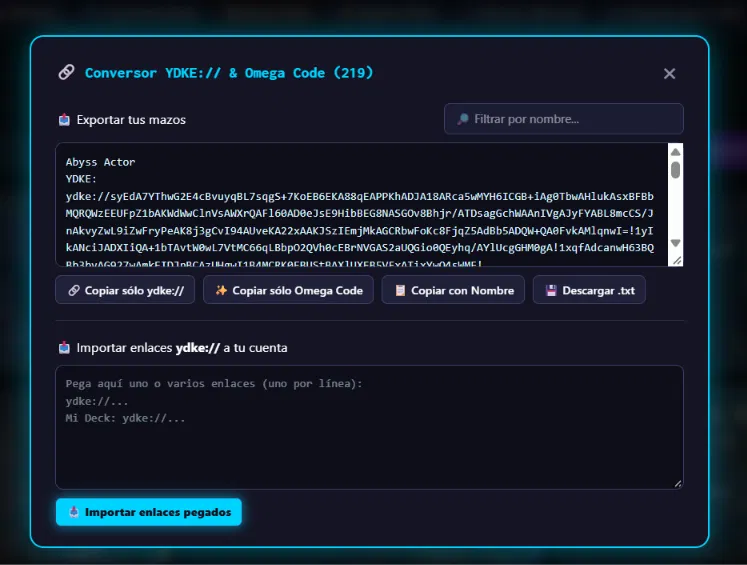
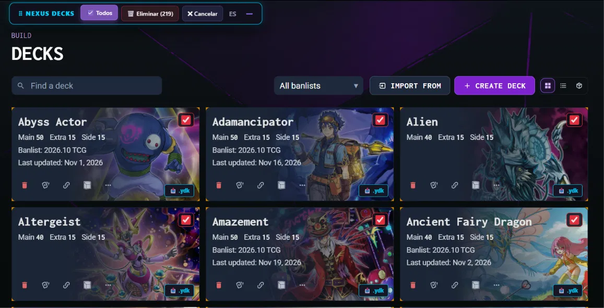
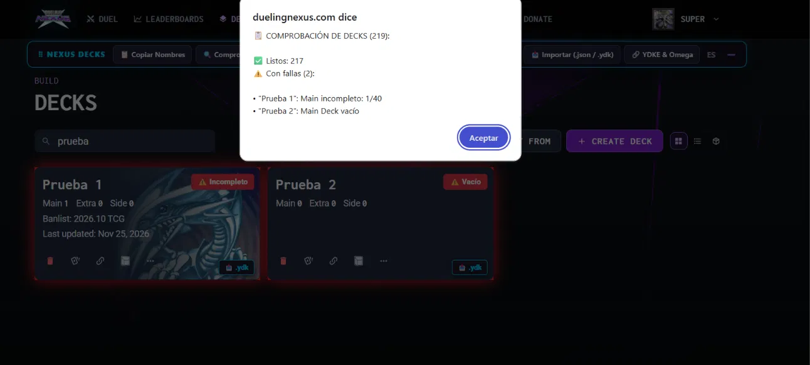

[English](README.md) | **Español**

# Super Nexus


Extensión de navegador (**Manifest V3**, cero dependencias) para gestionar mazos por lotes en **Dueling Nexus** (`/decks`): exportación `.ydk` / `.zip`, conversor `ydke://` y Omega Code, backups en JSON, comprobación de mazos y borrado múltiple. Pensada para conectar Nexus con **EDOPro** y **YGO Omega**. La interfaz está disponible en **español e inglés**.

> ⚠️ Proyecto no oficial. No está afiliado ni respaldado por Dueling Nexus, Konami, EDOPro ni YGO Omega. Todas las marcas pertenecen a sus respectivos dueños.

## Demo



<table>
  <tr>
    <td></td>
    <td></td>
  </tr>
  <tr>
    <td align="center"><sub>Conversor YDKE:// y Omega Code</sub></td>
    <td align="center"><sub>Borrado múltiple con selección</sub></td>
  </tr>
  <tr>
    <td colspan="2"></td>
  </tr>
  <tr>
    <td colspan="2" align="center"><sub>Comprobador de mazos: detecta incompletos y vacíos</sub></td>
  </tr>
</table>

## Por qué existe

Jugaba con mis hermanos en tres cuentas de Dueling Nexus y necesitaba los mismos mazos en todas, pero pasarlos uno por uno por enlace me quitaba tiempo de juego. Cuando Nexus tuvo un reinicio y varios mazos se borraron, entendí que necesitaba un respaldo real, y bajar cientos de `.ydk` con mi velocidad de descarga no era práctico. Llevar los mazos a EDOPro u Omega también era manual, y varios amigos migraban allá cuando perdían los suyos.

Consideré hacer un sistema aparte para gestionar mis mazos, pero una extensión era más simple de implementar y evitaba sobreingeniar. Además, la plataforma ya resuelve bien cosas como la banlist en el editor o importar un Omega Code individual, así que la extensión se enfoca en lo que falta: operar sobre muchos mazos a la vez.

Cada botón nació de algo que necesité:

- **Copiar nombres:** fue el primero. Lo hice para pasar mis mazos a Wheel of Names sin escribirlos a mano.
- **Backup en JSON:** exportar e importar, para respaldar y mover mazos entre mis cuentas.
- **Borrado múltiple:** para dejar una cuenta en cero y recargarla cuando actualizo mis mazos.
- **Comprobar decks:** a veces hay cartas en beta que después se eliminan de la plataforma y desaparecen de los mazos que las usaban. Con cientos de mazos, no había forma de saber cuáles quedaron incompletos o vacíos sin abrirlos uno por uno.
- **Exportar `.ydk` / `.zip`, `ydke://` y Omega Code:** para conectar Nexus con EDOPro y Omega, y que pasar mazos sea cómodo sin importar la plataforma que use cada jugador.

## Features

- **Panel flotante:** aparece solo en `/decks`. Se arrastra, se minimiza y recuerda dónde lo dejaste.
- **Interfaz en español e inglés:** un botón **ES / EN** en el panel cambia el idioma al instante. Arranca con el idioma de tu navegador y recuerda tu elección.
- **Copiar nombres:** pone en el portapapeles la lista de nombres de tus mazos, sin duplicados.
- **Comprobador de mazos:** revisa toda tu colección con las reglas de construcción (Main entre 40 y 60 cartas, Extra y Side máximo 15) y te dice cuántos están listos y cuáles tienen fallas, con el motivo (por ejemplo, *Main incompleto: 1/40* o *Main Deck vacío*). Los mazos con problemas se marcan en rojo como **Incompleto** o **Vacío**.
- **Borrado múltiple:** seleccionas mazos uno por uno o todos, y se eliminan en lote con barra de progreso.
- **Backup e importación:** respaldo completo en `.json`. Puedes importar un `.json` o varios `.ydk` a la vez (con Ctrl + clic), con una ventana de progreso que muestra el contador y el porcentaje.
- **Exportar un mazo a `.ydk`:** cada tarjeta recibe su propio botón, tanto en vista de cuadrícula como en lista y cubo.
- **Exportar todo a `.zip`:** un solo archivo con todos tus mazos en `.ydk`. Si lo descomprimes dentro de la carpeta `deck` de EDOPro, los tienes todos ahí al instante.
- **Conversor `ydke://` y Omega Code:** un modal con buscador para copiar los enlaces de tus mazos, generar el Omega Code y pegar varios `ydke://` (uno por línea) para importarlos a tu cuenta.

## Privacidad y permisos

El `manifest.json` no declara `permissions` ni `host_permissions`. Solo inyecta un content script en `*.duelingnexus.com`.

La extensión no tiene servidor propio, analíticas ni telemetría, y no envía datos a terceros. Lo único con lo que se comunica es Dueling Nexus, usando tu propia sesión abierta. No descarga ni ejecuta código externo. Lo único que guarda es local en tu navegador: la posición del panel y tu elección de idioma.

## Antes de usarla

- **Haz un backup `.json` antes de borrar.** El borrado múltiple es irreversible. Usa el botón de backup primero.
- **Depende de la estructura actual del sitio.** Super Nexus interactúa con el DOM de Dueling Nexus; si el sitio cambia su diseño, alguna función podría dejar de funcionar. Si te pasa, abre un [Issue](https://github.com/MalcoV999/super-nexus/issues).

## Arquitectura

Flujo de exportación masiva (sin librerías externas):

```
fetch('/api/list-decks.php')
  │
  ▼
IDs de cartas (Main / Extra / Side) ──► Formato .ydk
  │
  ▼
Empaquetador ZIP propio (CRC32 + cabeceras binarias con DataView)
  │
  ▼
Blob ──► Descarga (.zip)
```

Flujo del Omega Code:

```
Mazo ──► Lista de cartas ──► deflate-raw (CompressionStream) ──► Base64 ──► Omega Code
```

En la importación hay una pausa entre cada mazo: al mandar las peticiones demasiado seguidas, Nexus bloqueaba la página o devolvía error.

## Estructura del proyecto

```
super-nexus/
├── manifest.json             # Configuración MV3
├── content.js                # Lógica principal, panel y selector de idioma
├── styles.css                # Estilos del panel y modales
├── modules/
│   ├── i18n.js               # Traducciones ES / EN
│   └── decks.js              # Módulo de gestión de mazos
├── assets/
│   ├── en/                   # Screenshots (English UI)
│   └── es/                   # Capturas (interfaz en español)
├── LICENSE
├── README.md
└── README.es.md
```

## Qué aprendí

- **Cómo funciona una SPA por dentro:** usé la pestaña de red de DevTools para entender cómo Nexus hace sus peticiones y poder replicarlas desde la extensión sin romper la página. También tuve que lidiar con tarjetas que se pintan dinámicamente: usé `MutationObserver` con *debounce* para detectarlas y capturé los clics para que mi botón no abriera el editor del mazo.
- **Que ir rápido también falla:** al importar el JSON, mandar las peticiones muy seguidas bloqueaba la página o daba error, probablemente porque parecía tráfico sospechoso. Agregué una pausa entre cada mazo y una ventana de progreso con contador y porcentaje, porque con muchos mazos no saber cuánto faltaba me frustraba.
- **Ingeniería inversa de formatos:** estudié los formatos de EDOPro y Omega (`.ydk`, `ydke://`, Omega Code) y los adapté para convertir mazos de ida y vuelta con Nexus. Armé el ZIP a mano, sin librerías, para evitar dependencias de terceros y aprender cómo funciona el formato por dentro.
- **Agregar un segundo idioma después:** la primera versión tenía todos los textos escritos directamente en español. Los moví a un solo módulo (`i18n.js`) y los reemplacé por una consulta `ntT('clave')`, con marcadores `{variable}` para números y nombres. Agregar otro idioma ahora es agregar un diccionario.

## Stack

`JavaScript (ES6+)` · `Chrome Extension (Manifest V3)` · `Web APIs (CompressionStream, Pointer Events)` · `DOM MutationObserver & TreeWalker` · `CSS3`

## Instalación (navegadores basados en Chromium)

Funciona en **Chrome**, **Brave**, **Edge** y **Opera**. Es una extensión y no un userscript, así que no necesitas instalar **Tampermonkey** ni nada extra.

### Opción 1: Descargar Release (.zip)

1. Descarga el último `super-nexus-v1.1.0.zip` desde [Releases](https://github.com/MalcoV999/super-nexus/releases).
2. Extrae el `.zip` en una carpeta de tu PC.
3. Abre `chrome://extensions/` (o `brave://extensions/`, `edge://extensions/`).
4. Activa el **Modo de desarrollador** (esquina superior derecha).
5. Pulsa **Cargar descomprimida** y selecciona la carpeta que contiene los archivos de la extensión (`manifest.json`, `content.js`, `styles.css` y `modules`). Si al extraer Windows creó una carpeta dentro de otra, elige la de más adentro, la que muestra esos archivos.
6. Entra a la sección `/decks` en Dueling Nexus.

### Opción 2: Clonar el repositorio

```bash
git clone https://github.com/MalcoV999/super-nexus.git
```

Luego sigue los pasos 3 a 6 de la opción anterior, seleccionando la carpeta `super-nexus`.

## Roadmap

- [ ] Actualizar el listado de mazos dinámicamente tras importar o borrar (sin recargar toda la página con `location.reload()`)
- [ ] Importación masiva de Omega Codes en lote (complementando la importación individual de la plataforma)
- [ ] Soporte para Firefox (escritorio y Android) y Safari
- [ ] Publicación en Chrome Web Store / Edge Add-ons

## Autor

Desarrollado por [MalcoV999](https://github.com/MalcoV999).

## Licencia

Distribuido bajo la licencia MIT. Consulta el archivo [LICENSE](LICENSE) para más información.
