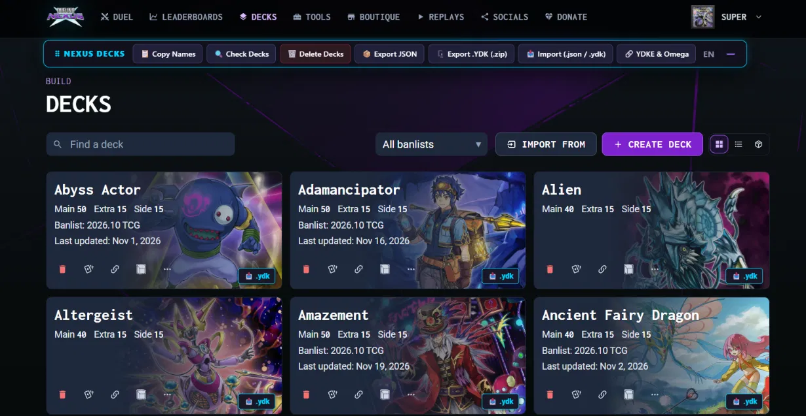
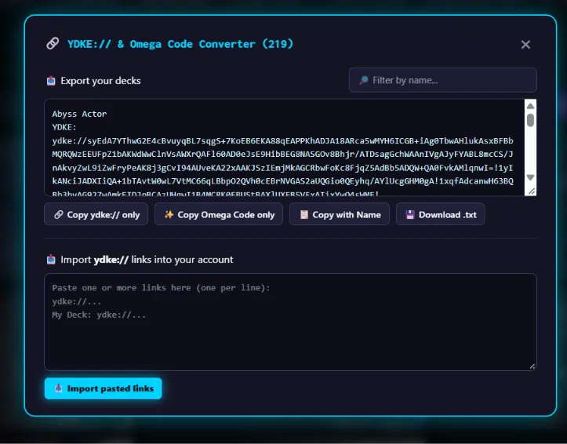
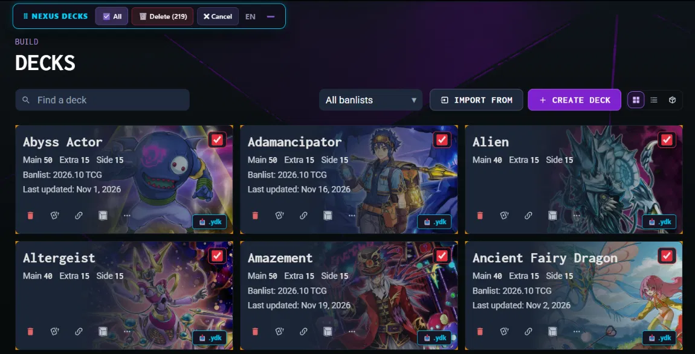
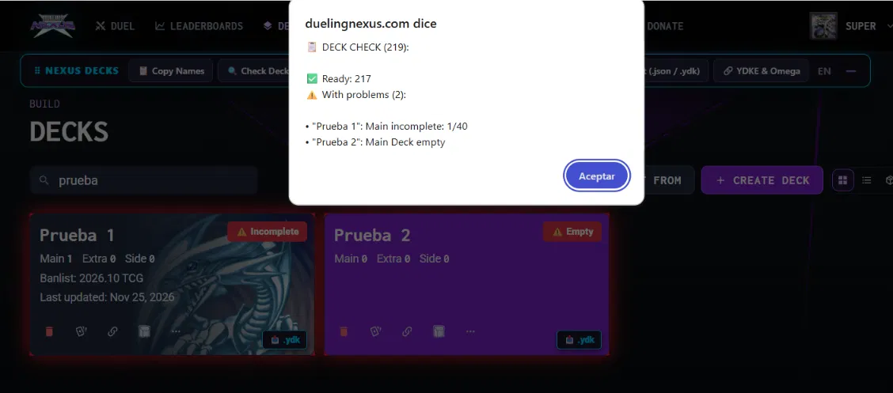

**English** | [Español](README.es.md)

# Super Nexus


Browser extension (**Manifest V3**, zero dependencies) for bulk deck management on **Dueling Nexus** (`/decks`): `.ydk` / `.zip` export, `ydke://` and Omega Code converter, JSON backups, deck checking and multi-delete. Built to bridge Nexus with **EDOPro** and **YGO Omega**. The interface is available in **English and Spanish**.

> ⚠️ Unofficial project. Not affiliated with or endorsed by Dueling Nexus, Konami, EDOPro or YGO Omega. All trademarks belong to their respective owners.

## Demo



<table>
  <tr>
    <td></td>
    <td></td>
  </tr>
  <tr>
    <td align="center"><sub>YDKE:// and Omega Code converter</sub></td>
    <td align="center"><sub>Multi-delete with selection</sub></td>
  </tr>
  <tr>
    <td colspan="2"></td>
  </tr>
  <tr>
    <td colspan="2" align="center"><sub>Deck checker: finds incomplete and empty decks</sub></td>
  </tr>
</table>

## Why it exists

I played with my brothers using three Dueling Nexus accounts and needed the same decks on all of them, but moving them one by one through share links cost me playing time. When Nexus went through a reset and several decks were wiped, I realized I needed a real backup, and downloading hundreds of `.ydk` files on my slow connection wasn't practical. Moving decks to EDOPro or Omega was also manual, and several friends moved over there after losing theirs.

I considered building a separate system to manage my decks, but an extension was simpler to implement and avoided over-engineering. The platform also already handles some things well, like the banlist in the editor or importing a single Omega Code, so the extension focuses on what's missing: working on many decks at once.

Every button came from something I needed:

- **Copy names:** the first one. I built it to feed my deck names into Wheel of Names without typing them.
- **JSON backup:** export and import, to back up and move decks between my accounts.
- **Multi-delete:** to wipe an account and reload it when I update my decks.
- **Check decks:** sometimes beta cards get removed from the platform later and vanish from the decks that used them. With hundreds of decks, there was no way to know which ones ended up incomplete or empty without opening them one by one.
- **Export `.ydk` / `.zip`, `ydke://` and Omega Code:** to connect Nexus with EDOPro and Omega, so moving decks is comfortable whatever platform each player uses.

## Features

- **Floating panel:** shows up only on `/decks`. Draggable, collapsible, and it remembers where you left it.
- **English / Spanish interface:** an **ES / EN** button in the panel switches the language instantly. It starts in your browser's language and remembers your choice.
- **Copy names:** puts the list of your deck names on the clipboard, without duplicates.
- **Deck checker:** scans your whole collection against the construction rules (Main 40–60 cards, Extra and Side up to 15) and tells you how many are ready and which ones have problems, with the reason (for example, *Main incomplete: 1/40* or *Main Deck empty*). Problem decks are highlighted in red as **Incomplete** or **Empty**.
- **Multi-delete:** select decks one by one or all at once, and delete them in bulk with a progress bar.
- **Backup and import:** full backup as `.json`. You can import a `.json` or several `.ydk` files at once (with Ctrl + click), with a progress window showing the counter and percentage.
- **Export a single deck to `.ydk`:** every deck card gets its own button, in grid, list and cube views.
- **Export everything to `.zip`:** a single file with all your decks as `.ydk`. Unzip it inside EDOPro's `deck` folder and they're all there instantly.
- **`ydke://` and Omega Code converter:** a modal with search to copy your decks' links, generate the Omega Code, and paste several `ydke://` links (one per line) to import them into your account.

## Privacy and permissions

The `manifest.json` declares no `permissions` or `host_permissions`. It only injects a content script on `*.duelingnexus.com`.

The extension has no server of its own, no analytics and no telemetry, and it sends no data to third parties. The only thing it talks to is Dueling Nexus, using your own logged-in session. It doesn't download or run external code. The only things it saves are local to your browser: the panel position and your language choice.

## Before you use it

- **Make a `.json` backup before deleting.** Multi-delete cannot be undone. Use the backup button first.
- **It depends on the current structure of the site.** Super Nexus reads and manipulates the DOM and requests of Dueling Nexus; if the site changes, some features may stop working. If that happens, open an [Issue](https://github.com/MalcoV999/super-nexus/issues).

## Architecture

Bulk export flow (no external libraries):

```
fetch('/api/list-decks.php')
  │
  ▼
Card IDs (Main / Extra / Side) ──► .ydk format
  │
  ▼
Custom ZIP packer (CRC32 + binary headers with DataView)
  │
  ▼
Blob ──► Download (.zip)
```

Omega Code flow:

```
Deck ──► Card list ──► deflate-raw (CompressionStream) ──► Base64 ──► Omega Code
```

Imports include a pause between each deck: when requests were sent too close together, Nexus froze the page or returned an error.

## Project structure

```
super-nexus/
├── manifest.json             # MV3 configuration
├── content.js                # Main logic, panel and language switch
├── styles.css                # Panel and modal styles
├── modules/
│   ├── i18n.js               # ES / EN translations
│   └── decks.js              # Deck management module
├── assets/
│   ├── en/                   # Screenshots (English UI)
│   └── es/                   # Capturas (interfaz en español)
├── LICENSE
├── README.md
└── README.es.md
```

## What I learned

- **How a SPA works from the inside:** I used the DevTools network tab to understand how Nexus makes its requests so I could replicate them from the extension without breaking the page. I also had to deal with cards that render dynamically: I used `MutationObserver` with debounce to detect them and captured clicks so my button wouldn't open the deck editor.
- **Going fast also fails:** when importing the JSON, sending requests too close together froze the page or threw errors, probably because it looked like suspicious traffic. I added a pause between each deck and a progress window with a counter and percentage, because with many decks not knowing how much was left frustrated me.
- **Reverse engineering formats:** I studied the EDOPro and Omega formats (`.ydk`, `ydke://`, Omega Code) and adapted them to convert decks back and forth with Nexus. I built the ZIP by hand, with no libraries, to avoid third-party dependencies and to learn how the format works inside.
- **Adding a second language after the fact:** the first version had every text hard-coded in Spanish. I moved them all into a single module (`i18n.js`) and replaced them with a `ntT('key')` lookup, with `{variable}` placeholders for numbers and names. Adding another language now means adding one dictionary.

## Stack

`JavaScript (ES6+)` · `Chrome Extension (Manifest V3)` · `Web APIs (CompressionStream, Pointer Events)` · `DOM MutationObserver & TreeWalker` · `CSS3`

## Installation (Chromium-based browsers)

Works on **Chrome**, **Brave**, **Edge** and **Opera**. It's an extension, not a userscript, so you don't need to install **Tampermonkey** or anything else.

### Option 1: Download the Release (.zip)

1. Download the latest `super-nexus-v1.1.0.zip` from [Releases](https://github.com/MalcoV999/super-nexus/releases).
2. Extract the `.zip` into a folder on your PC.
3. Open `chrome://extensions/` (or `brave://extensions/`, `edge://extensions/`).
4. Turn on **Developer mode** (top-right corner).
5. Click **Load unpacked** and select the folder that contains the extension files (`manifest.json`, `content.js`, `styles.css` and `modules`). If Windows created a folder inside another folder when extracting, pick the innermost one, the one that shows those files.
6. Go to the `/decks` section on Dueling Nexus.

### Option 2: Clone the repository

```bash
git clone https://github.com/MalcoV999/super-nexus.git
```

Then follow steps 3 to 6 above, selecting the `super-nexus` folder.

## Roadmap

- [ ] Refresh the deck list dynamically after importing or deleting (without reloading the whole page with `location.reload()`)
- [ ] Bulk import of Omega Codes (complementing the platform's single import)
- [ ] Firefox (desktop and Android) and Safari support
- [ ] Publish on the Chrome Web Store / Edge Add-ons

## Author

Developed by [MalcoV999](https://github.com/MalcoV999).

## License

Distributed under the MIT license. See the [LICENSE](LICENSE) file for more information.
